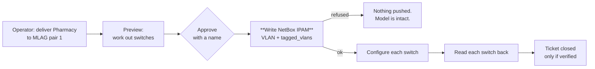

# NetBox IPAM as the source of truth

**Provenance:** `INIT-004-netbox-ipam`.

---

## The problem this fixed

Before this work, the lab's NetBox had:

| | |
| --- | --- |
| IPAM VLANs | **0** |
| VLAN groups | **0** |
| Tenants | **0** |
| `leaf-01 eth5` mode | **empty** |
| `leaf-01 eth5` tagged VLANs | **[]** |

The demo's VLAN intent lived in a Python tuple:

```python
BASE_VLANS: tuple[int, ...] = (100, 110, 120, 130, 140)
```

So the tool changed switches and NetBox learned nothing. That is a *rogue system* by any
definition a network director would use: the network changed, the source of truth did not, and
the next person to read NetBox is misled. It is also worse than useless at a customer whose
objection to buying NetBox is that they already have an IPAM — you cannot argue "NetBox is your
source of truth" while the truth lives in a tuple.

---

## What NetBox actually models

| Object | Field | What it means |
| --- | --- | --- |
| `ipam.vlan` | `vid`, `name` | The VLAN itself |
| `ipam.vlan` | `tenant`, `group`, `site` | Who owns it, where it is scoped |
| `ipam.prefix` | `prefix`, `vlan` | The layer-3 plan for that VLAN |
| `dcim.interface` | `mode` | **`tagged` is what makes a port a trunk** |
| `dcim.interface` | `tagged_vlans` | The allow-list, as real foreign keys |

So "add VLAN 150 to the server trunk" has a complete, checkable representation. No tuple.

---

## The rule: model first, then the device



**NetBox is written first, and a write failure stops the change.** If the order were reversed, a
failure would leave a switch carrying a VLAN that the model does not know about — the exact
state this initiative exists to prevent.

---

## Four bugs worth remembering

Each of these was found by running against a real NetBox rather than a fake, and each would have
been invisible in a demo until someone asked.

### 1. `mode` is a choice object, not a string

```json
{"mode": {"value": "tagged", "label": "Tagged"}}
```

`str(record["mode"]) != "tagged"` is always true, so **every trunk was skipped**. The page said
"no server trunk declared" for switches that plainly had one.

### 2. `tagged_vlans` wants primary keys, not VLAN numbers

```
{"tagged_vlans": ["Invalid pk \"100\" - object does not exist."]}
```

VLAN 100 has pk 7 in this lab. The read path deals in `vid` (the number a human reads); the write
path needs `id` (the pk). They are different integers and conflating them fails loudly — which is
lucky.

### 3. A VLAN id is not a subnet

`10.100.312.0/24` is not valid IPv4 — octets stop at 255. Deriving a prefix from a VLAN id works
until it doesn't. NetBox 4.1.11 answers with HTTP 500 `KeyError: 'data'` rather than a validation
error, so the actual mistake is buried. Prefixes are now a **plan**, not a derivation, and are
validated before they are sent.

| Service | VLAN | Prefix |
| --- | --- | --- |
| General servers | 100 | `10.100.100.0/24` |
| Server management | 110 | `10.100.110.0/24` |
| Storage | 120 | `10.100.120.0/24` |
| Backup | 130 | `10.100.130.0/24` |
| Voice | 140 | `10.100.140.0/24` |
| Philips monitoring | 150 | `10.100.150.0/24` |
| Radiology / PACS | 312 | `10.101.12.0/24` |
| Pharmacy | 333 | `10.101.33.0/24` |

### 4. An empty IPAM is not a read failure

Those are different, and confusing them either breaks a fresh install or lies to the page. An
**empty** IPAM returns empty and the caller may fall back (announcing that it did). A **read
failure** raises, because a source of truth that cannot be reached must never be silently
replaced by a tuple.

---

## Commands

```powershell
.\run.ps1 ipam              # report what would be modelled
.\run.ps1 ipam --apply      # write tenants, VLANs, prefixes and trunk membership
.\run.ps1 verify-service    # prove a change reaches NetBox and the switches
```

`seed_ipam.py` is idempotent. Interface VLAN lists are **unioned, never replaced** — a replace
would silently drop a VLAN another team put on that trunk.

---

## What is still deliberately not modelled

- **IP addresses per host.** The fabric's own config context holds the gateway addresses; IPAM
  holds the prefix. Allocating an address per switch port is not what this demo shows and would
  invent data.
- **The server hosts themselves.** `philips-01/02` exist in the container lab but not as NetBox
  devices. A real engagement would model them, and then "which jack does this server use" would
  resolve from cables — the way the twix access-request tool does it.
- **The config context.** It still carries the EVPN/underlay/overlay settings that render the
  fabric configuration. That is *configuration*, not IPAM, and the two are allowed to coexist:
  the VLAN list is now IPAM, and the config context no longer needs to be the authority for it.

---

## Where things live

| Path | What |
| --- | --- |
| `workbench/netbox_ipam.py` | Reading VLANs, trunks, and building intent from IPAM |
| `workbench/netbox_ipam_write.py` | Writing intent back: VLANs, `tagged_vlans`, rollback |
| `scripts/seed_ipam.py` | One-time model: tenants, VLANs, prefixes, trunks |
| `tests/test_netbox_ipam.py` | The read/write contract, including NetBox's field shapes |
